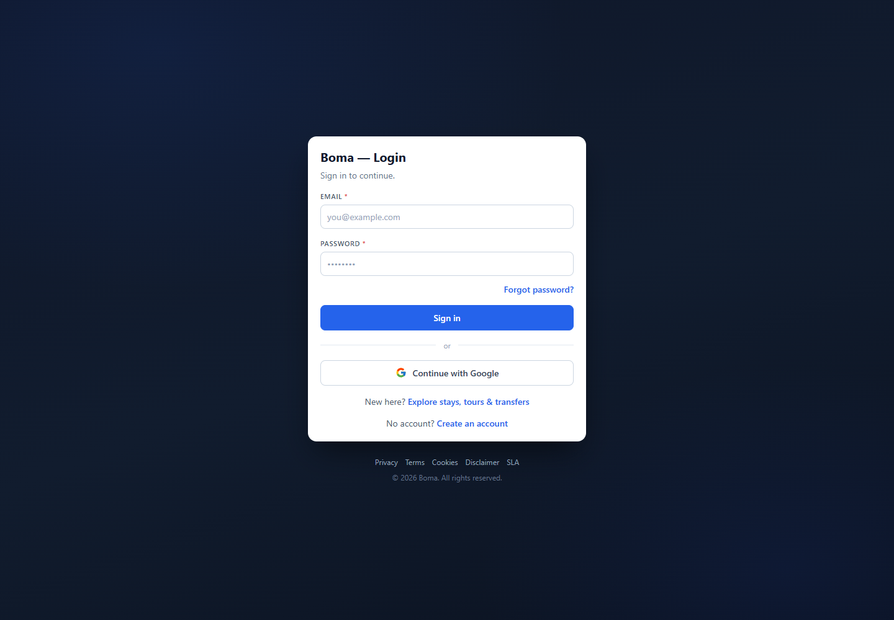
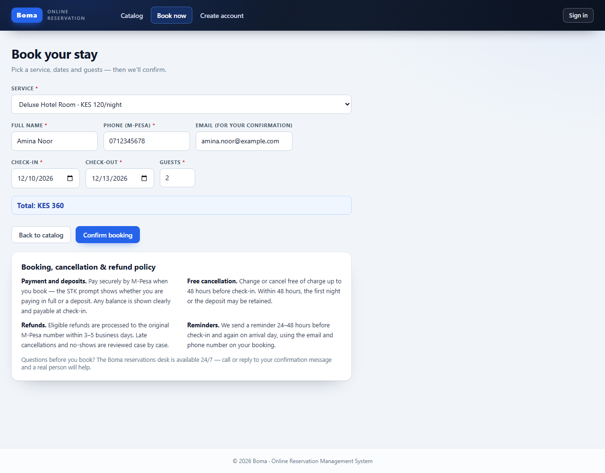
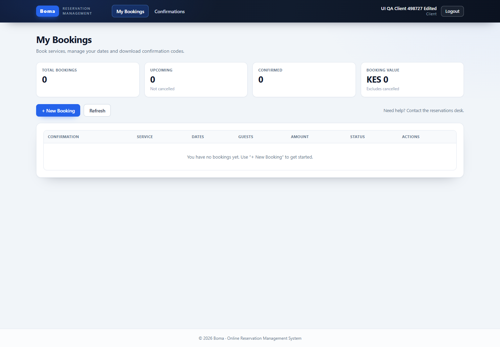
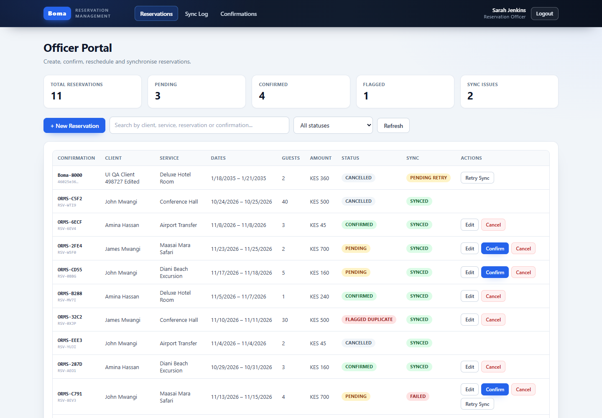
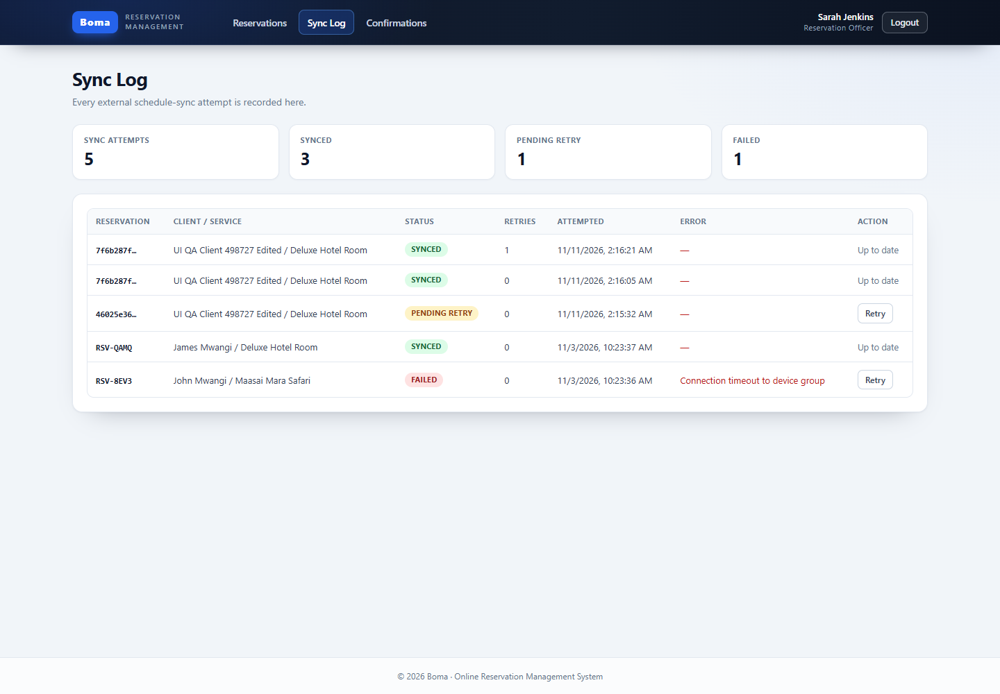
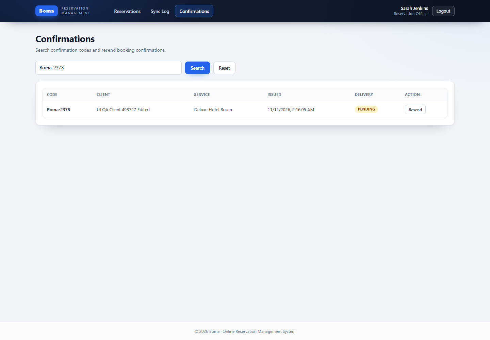
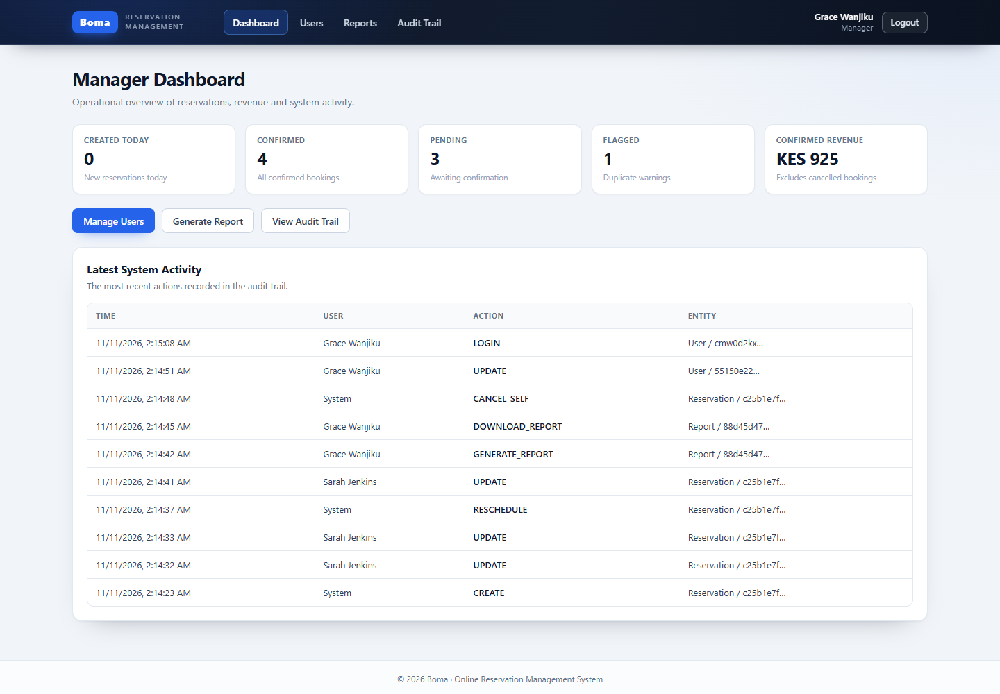
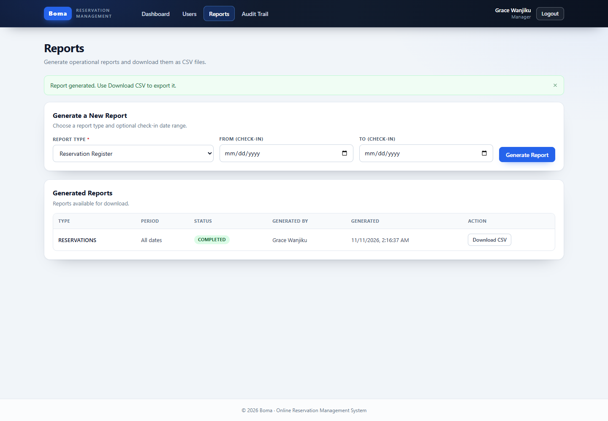
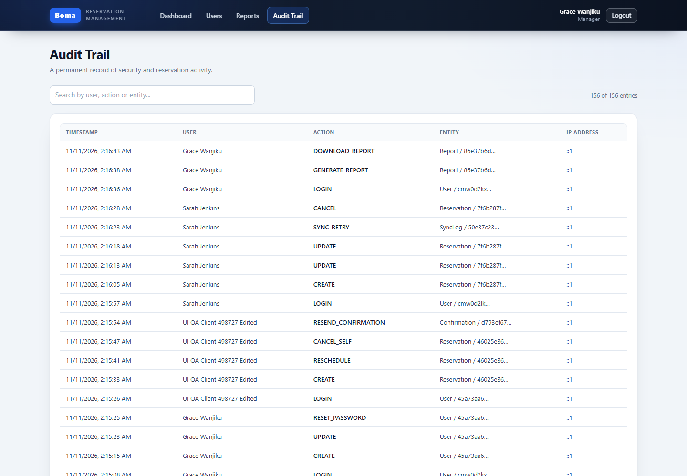
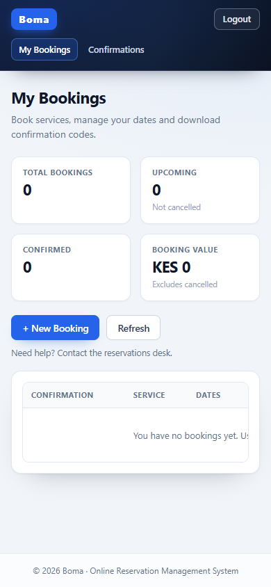

# CHAPTER THREE: SYSTEM IMPLEMENTATION

## 3.1 Introduction

This chapter focuses on the implementation of the Boma Online Reservation Management System, detailing the journey from development to deployment for a Kenyan tourism and hospitality booking platform. It begins with the development process, explaining how the design specifications and requirements were transformed into a working web application using suitable programming tools, frameworks and technologies. The chapter then discusses the testing phase, highlighting the methods employed to identify and correct errors, ensure system reliability, and confirm that all functionalities meet user requirements. Finally, it covers the deployment process, describing how the system was prepared for actual use, including installation, configuration, and user accessibility considerations. Throughout the chapter, challenges encountered during each stage are explained along with the solutions applied, providing insight into the practical aspects of system implementation.

The system was built around three core objectives: preventing duplicate and outdated reservations through automated detection and validation; synchronising reservation schedules in real time; and automating booking confirmation management by capturing, storing and retrieving proof of confirmation. These objectives guided both the user interface design and the business logic described in this chapter.

## 3.2 User Interface Development

The user interface was developed as a React single-page application styled around a dark blue and slate palette. Public pages (catalog, booking, registration and password reset) are accessible without authentication, while manager, reservation officer and client portals require a valid session and render only the functions permitted to that role.

### 3.2.1 Login Page Development

The login form allows users to securely access the Boma system by entering a valid email address and password. It captures the credentials, validates them against stored password hashes, and establishes an authenticated session. Upon successful login, managers are redirected to the manager dashboard, reservation officers to the officer portal, and clients to My Bookings. Incorrect credentials produce a clear error message, repeated failures trigger a 60-second pause on the form, and accounts that exceed five failed attempts are locked for 15 minutes with an explanatory modal, ensuring secure and controlled system access.

### 3.2.2 Public Service Catalog

The public catalog presents the tourism services offered — accommodation, safari tours, beach excursions, airport transfers and conference facilities — in a booking.com-style layout. Each card displays a real photograph, the service name, its location, maximum guest capacity, the price in Kenyan shillings with its pricing unit, inclusion tags and a short description. Search and service-type filters help guests find relevant offers quickly, while supporting sections explain instant confirmation, secure M-Pesa payment, free cancellation and the 24/7 reservations desk. If the database is momentarily unavailable, the catalog continues to load from the last successful cache or a static fallback, so the public site never goes down completely.

### 3.2.3 Public Booking Page

The booking page captures the selected service, check-in and check-out dates, number of guests, the lead guest's full name, a phone number (used for confirmation and M-Pesa payment) and an optional email address. The estimated total is calculated and displayed before submission using the same pricing rules as the server. On confirmation, the guest immediately receives a unique Boma-XXXX confirmation code, with an option to pay via M-Pesa through an STK push sent to their phone.

### 3.2.4 Client Portal (My Bookings)

The client portal lists only the signed-in guest's reservations, showing the confirmation code, service, dates, guests, amount, reservation status and a payment column that displays either a "Pay" action, a pending state, or the M-Pesa receipt once paid. Guests can reschedule or cancel their bookings from the same table, subject to the same validation rules enforced by the API.

### 3.2.5 Reservation Officer Portal

The reservation officer portal gives front-office staff a summary of total, pending, confirmed, flagged and sync-issue reservations, together with a full reservation table. Officers can create reservations with automatic pricing, confirm or cancel bookings, retry failed synchronisations and open the sync log or confirmations pages from the shared navigation bar.

### 3.2.6 Sync Log Page

The sync log page displays every reservation change that must be synchronised with external scheduling systems. Each entry shows the related client, service, sync status, retry count, timestamps and any error message, and provides a retry action so that failed or pending synchronisations can be resolved without database intervention.

### 3.2.7 Confirmations Page

The confirmations page allows staff to search confirmations by code, client name or email, review the stored confirmation payload and delivery status, and resend a confirmation. Resending performs real delivery through the configured email and SMS channels and records whether delivery succeeded or failed.

### 3.2.8 Manager Dashboard

The manager dashboard provides an operational overview: reservations created today, confirmed bookings, pending and flagged reservations, confirmed revenue and the latest audit-trail activity. Quick links give managers direct access to user management, report generation and the full audit trail.

### 3.2.9 Reports Centre

The reports centre lets managers generate filtered reports for a chosen date range and export them as CSV files. Summary cards and tables present reservation counts, revenue totals and status breakdowns in a form that can be reviewed on screen or opened in a spreadsheet for further analysis.

### 3.2.10 Audit Trail

The audit trail records security-relevant and business-relevant actions — sign-ins, reservations, confirmations, payments, user changes and password resets — with the acting user, timestamp, entity and supporting details. Managers can review this page to investigate incidents or verify that operations were performed correctly.

### 3.2.11 Navigation Bar and Shared Layout

The navigation bar is role-aware. Public visitors see links to the catalog, booking page, account registration and sign-in; authenticated users see their portal links, their name and role, and a sign-out action. The shared layout keeps the Boma identity consistent across every page and adapts to mobile screens, ensuring easy navigation and efficient system interaction.

## 3.3 Logic Development

### 3.3.1 Authentication and Access Control

User authentication is implemented with JSON Web Tokens and bcrypt password hashing. The login handler normalises the submitted email, retrieves the user record, verifies the password hash and checks that the account is active. Five consecutive failures lock the account for fifteen minutes, and the API returns HTTP 423 so the interface can explain the situation. Successful authentication returns a signed token containing the user identifier and role, which the client stores and attaches to subsequent requests. Middleware then verifies the token and enforces role restrictions, so a client cannot call staff-only endpoints and an unauthenticated request is rejected with HTTP 401. Every sign-in, failed attempt and lockout-related event is written to the audit trail.

### 3.3.2 Reservation Management and Duplicate Prevention (Objective I)

Reservation creation validates that the service exists and is active, that the guest count does not exceed capacity, and that the dates are coherent. Before saving, the API performs an automated duplicate check for an active reservation belonging to the same client, for the same service and for the same dates. If a match is found, the request is rejected with HTTP 409 and the existing reservation reference is returned, preventing accidental double bookings. Conflicting records can also be marked FLAGGED_DUPLICATE so that staff can review them.

The duplicate check is not a simple read-then-insert. It runs inside a serializable database transaction together with the reservation insert, the confirmation code and the initial sync record, so two requests arriving at the same instant cannot both pass the check. PostgreSQL serialises the transactions: one commits, while the other either sees the committed row and receives HTTP 409 or is retried after a serialization conflict. Transient connection losses from the hosted pooler are also retried safely — if a retry finds that the earlier attempt actually committed, it returns that booking instead of creating a second one.

For outdated updates, every reservation carries a version number. Updates require the client to submit the version it last read; the server compares it with the stored version, rejects stale writes with HTTP 409 ("this reservation was changed by another user"), and increments the version on every successful change. This optimistic locking mechanism guarantees that two officers editing the same booking cannot silently overwrite each other's work.

### 3.3.3 Real-Time Schedule Synchronisation (Objective II)

Every reservation creation, change or cancellation writes a SyncLog entry describing the change and its synchronisation status. The sync pipeline processes these entries and records retry counts, attempt timestamps and error messages, allowing staff to retry failed or pending synchronisations from the sync log page. The API also broadcasts reservation updates over Socket.IO to connected staff clients, so the manager and officer views reflect schedule changes without a manual refresh. Failed synchronisations therefore remain visible and recoverable instead of silently disappearing.

### 3.3.4 Automated Booking Confirmation Management (Objective III)

When a reservation is saved, the system automatically generates a unique confirmation code in the Boma-XXXX format and stores it in the Confirmation table together with the reservation reference, a JSON payload and a delivery status. The confirmation row is written inside the same transaction as the reservation, so a booking cannot exist without the proof of confirmation Objective III requires. The same operation sends the confirmation to the guest by email (HTML template with the code and booking summary) and by SMS when a phone number is available, then records the outcome as SENT or FAILED. Staff and clients can search confirmations by code, client name or email, resend them, and retrieve a scannable QR payload. If no mail or SMS provider is configured, the system logs the message instead of dropping it silently, and password-reset responses expose a development token only in that configuration.

A background scheduler extends this communication beyond the initial confirmation. Every fifteen minutes it checks confirmed reservations and sends a reminder when check-in is tomorrow (roughly 24–48 hours ahead) and again on the day of arrival. Each stage is recorded in the AuditLog as REMINDER_48H or REMINDER_SAME_DAY, so the same guest is never reminded twice even after a server restart. Reminders use the same email and SMS channels and include the confirmation code, dates, guest count and the cancellation policy.

### 3.3.5 M-Pesa Payments and Automatic Reservation Confirmation

Payments are integrated with Safaricom's Daraja API. When a guest chooses to pay, the server normalises the Kenyan phone number, obtains an OAuth access token, and sends an STK push request for the amount due. The pending payment is stored against the reservation and correlated using a `MPESA-PENDING-<CheckoutRequestID>` reference. Safaricom then calls the public callback endpoint with the result: on success the payment is marked COMPLETED with the M-Pesa receipt number and the reservation is automatically confirmed; on failure the payment is marked FAILED. The callback is idempotent and always acknowledges Safaricom to avoid retry storms. Guests can poll the payment status from the public booking page or the client portal, and staff can record refunds against completed payments.

The upfront amount is configurable through `MPESA_DEPOSIT_PERCENT` (1–100, default 100). Setting it to, for example, 30 collects a 30% deposit to secure the slot and leaves the balance payable at the property. The booking page shows whether the guest is paying in full or a deposit, the STK prompt confirms the exact amount, and the amount stored on the payment record matches what Safaricom was asked to collect.

Critically, the system never fabricates a completed payment: if the Daraja credentials are not configured, initiation is refused with HTTP 503 and the guest is honestly advised to pay at the front desk. All payment values are computed server-side from the reservation total to prevent tampering.

### 3.3.6 Reports, Audit and Dashboard Aggregation

The dashboard endpoint aggregates reservation counts by status and calculates confirmed revenue. Report generation stores the requested filters, computes matching reservation totals, and produces a CSV export served with the correct content type. Audit logging wraps authentication and every significant mutation, recording the actor, action, entity, details, IP address and user agent, so that the system's behaviour can be reconstructed when needed.

## 3.4 Testing

Testing combined automated API regression scripts, browser-driven end-to-end checks and manual walkthroughs.

**I. User Login Feature**
Testing action: attempted sign-in with valid and invalid credentials, including inactive accounts and repeated failures.
Result: valid credentials logged in with the correct role redirect; invalid credentials returned a clear error; five failures locked the account.
Correction: the lockout response was given a dedicated HTTP 423 status and modal explanation so users understand why access is paused.

**II. Reservation Entry and Duplicate Prevention**
Testing action: created sample reservations for the same client, service and dates, including two identical requests submitted simultaneously.
Result: the first booking saved successfully; the simultaneous request received HTTP 409 with the existing reservation reference. No duplicate row was created.
Correction: the duplicate check and insert were moved into one serializable transaction so the rule holds under concurrency and on every entry point, including public bookings, not just the user interface.

**III. Concurrent Editing and Schedule Sync**
Testing action: simulated two officers editing the same reservation and reviewed the sync log after changes.
Result: the stale update was rejected with HTTP 409, the version number incremented correctly, and a sync record was created for each change.
Correction: version-based optimistic locking was enforced on every update, and the retry action was added for failed synchronisations.

**IV. Confirmation Generation and Delivery**
Testing action: booked reservations with and without email addresses, searched for the resulting confirmation codes, and resent a confirmation.
Result: every reservation received a unique Boma-XXXX code; delivery was recorded as SENT when a channel accepted the message, and the resend performed an actual delivery attempt.
Correction: delivery status recording and the SMTP/Africa's Talking fallbacks were added so a missing provider is logged rather than silently ignored.

**V. Payment Integrity**
Testing action: initiated an M-Pesa payment with and without Daraja credentials configured, and reviewed the callback handling.
Result: without credentials the API returned an honest HTTP 503 with a front-desk fallback message; with credentials, the STK request produced a checkout reference and the reservation was only confirmed after a successful callback.
Correction: the original simulated instant-completion stub was removed entirely so the system can never record a payment that did not happen.

**VI. Automated Reminders**
Testing action: confirmed a booking with check-in on the following day and ran the reminder sweep twice; reviewed the audit trail afterwards.
Result: the first sweep delivered the email and SMS reminder and recorded REMINDER_48H; the second sweep sent nothing because the stage was already recorded. The audit trail showed the reminder against the reservation.
Correction: the reminder stage is written to the AuditLog after delivery so restarts and repeated sweeps cannot spam the guest, while a crash before recording causes at most one repeat rather than a missed reminder.

**VII. Report Generation**
Testing action: generated reports for different date ranges and exported them as CSV.
Result: totals matched the reservation records, filters applied correctly, and exported files opened with the expected rows.
Correction: date-range boundaries were normalised so end-of-day records are included.

**VIII. Navigation and Buttons**
Testing action: walked through every menu, button and form in the manager, officer and client portals, and reviewed the public pages.
Result: all links and actions performed their intended functions; the browser console reported no errors.
Correction: minor layout and wording issues found during the walkthrough were fixed.

## 3.5 Deployment

The Boma system is built on React and TypeScript for the client, Node.js and Express with Socket.IO for the API, Prisma as the data-access layer, and PostgreSQL hosted on Supabase as the database. Configuration is supplied entirely through environment variables — database URL, JWT secret, public client URL, SMTP settings, Africa's Talking credentials and M-Pesa Daraja credentials — so no secrets are stored in source code.

The deployment process comprises the following steps:

1. **Environment configuration:** the `.env` file is populated from the documented `.env.example` template, including the Supabase session-pooler connection string and a strong random JWT secret.
2. **Database preparation:** the Prisma schema is applied with `prisma migrate deploy` (or `prisma db push` in development) and the Prisma client is generated.
3. **Client build:** `npm run build` compiles the React application into `client/build`.
4. **Production start:** with `NODE_ENV=production`, the API serves the built client and the API from a single origin on port 4000, with SPA fallback so client-side routes resolve correctly.
5. **Process supervision:** the included `ecosystem.config.js` runs the application under PM2 with automatic restarts, so the service recovers from crashes without manual intervention.
6. **TLS and reverse proxy:** a TLS-terminating reverse proxy (nginx or Caddy) fronts the application and provides HTTPS for the public domain, which also serves as the M-Pesa callback origin.
7. **Health monitoring:** the `/health` endpoint probes the database with a two-second timeout and reports `{"status":"ok","db":"up"}` or a degraded state, providing a simple uptime check.

The system currently runs in a controlled local deployment, with the web application on `http://localhost:3000` and the API on `http://localhost:4000`. All production artefacts — build scripts, PM2 configuration, environment template, `.gitignore`, and a GitHub Actions workflow that validates the Prisma schema, type-checks the server and builds the client on every push — are included so the same codebase can be promoted to a public cloud host or virtual server by following the steps above.

Several challenges were encountered and resolved during implementation. The Supabase connection pooler intermittently dropped TLS handshakes from the development network; the server now retries the connection, pins the pooler certificate chain where required, and boots in a degraded mode that keeps the public catalog online while database-backed endpoints return clean service-unavailable responses. Express 4 does not forward errors thrown inside asynchronous handlers, which originally allowed a single database error to terminate the process; a handler wrapper, process-level safety nets and a JSON error middleware now contain such failures. Finally, safeguarding payment honesty required removing all simulated success paths, so that a reservation can only become paid through a verified Safaricom callback or an authorised manual confirmation.

# CHAPTER FOUR: CONCLUSION AND RECOMMENDATION

## 4.1 Conclusion

The aim of this project was to develop the Boma Online Reservation Management System that improves the efficiency of managing tourism and hospitality bookings. Chapter One discussed the problem statement, justification of the study and the objectives of the system. It highlighted the challenges faced by tourism operators who rely on manual records and fragmented communication, such as duplicate bookings, outdated schedules and lost confirmations. Chapter Two focused on the design and modelling of the system using diagrams such as the Data Flow Diagram, Entity Relationship Diagram, Use Case Diagram and Class Diagram to illustrate how the system operates. Chapter Three described the implementation of the system, including the development of the user interface, logic implementation using React, Node.js, Express and Prisma, system testing, and deployment preparation.

The developed system successfully automates the core reservation workflow. It prevents duplicate and outdated reservations through atomic duplicate detection and version-based optimistic locking; it synchronises schedule changes through a tracked retry pipeline with real-time staff notifications; and it automates booking confirmation management by generating, storing, delivering and retrieving Boma-XXXX confirmation codes. In addition, the system provides secure role-based access, M-Pesa STK push payments with automatic confirmation and configurable upfront deposits, automated 24–48 hour and same-day reminders, clearly displayed cancellation and refund policies, email and SMS delivery, report generation with CSV export, and a complete audit trail. Supporting capabilities such as public self-service booking, registration and password reset make the platform usable by guests without staff intervention.

During the development of this project, I gained practical knowledge in full-stack web development with React and TypeScript, API design with Node.js and Express, database modelling and access with Prisma and PostgreSQL, payment integration with the Safaricom Daraja API, and deployment preparation with process managers and continuous integration. Several challenges were encountered, including intermittent cloud database connectivity, asynchronous error handling, and ensuring that payment states remain truthful. Solving these challenges strengthened my problem-solving, debugging and system-design skills.

## 4.2 Recommendation

Although the Boma Online Reservation Management System functions effectively, there are several improvements that future developers can implement to enhance its capabilities. One improvement would be integrating additional payment channels such as card payments and bank transfers, complementing the existing M-Pesa flow, so that international guests can pay using their preferred method.

Another improvement would be connecting the platform to external channel managers and property management systems used by hotels and tour operators. This would allow availability and rates to be synchronised across booking platforms automatically, reducing the risk of overbooking when a property sells through multiple channels.

Future developers may also consider adding multi-property support so that a single deployment can manage several lodges, camps or excursion brands with separate staff roles and reporting. Offline-first capabilities and a progressive web application mode would improve resilience in areas with unreliable connectivity, while migrating rate limiting and session state to a shared store such as Redis would allow the application to scale horizontally across multiple server instances.

Finally, the system can be enhanced with advanced analytics and graphical dashboards that provide deeper insight into booking trends, occupancy, revenue per service and guest retention. Scheduled database backups with tested restores, centralised logging and error monitoring, accessibility audits, and a comprehensive automated test suite running in continuous integration would further strengthen operational reliability as real guest data accumulates.

# REFERENCES

Buhalis, D., & Law, R. (2008). Progress in information technology and tourism management: 20 years on and 10 years after the Internet—The state of eTourism research. *Tourism Management, 29*(4), 609–623.

Djohan, T., & Stefvy. (2023, April). Inventory shortages and poor management systems negatively affect customer satisfaction in the bookstore industry. *Research Synergy Press Journals*. https://www.researchgate.net/publication/371763839

Gretzel, U., Sigala, M., Xiang, Z., & Koo, C. (2015). Smart tourism: Foundations and developments. *Electronic Markets, 25*(3), 179–188.

International Telecommunication Union (ITU). (2023). *Measuring digital development: Facts and figures 2023*. https://www.itu.int/en/Pages/default.aspx

Laudon, K. C., & Laudon, J. P. (2022). *Management information systems: Managing the digital firm* (17th ed.). Pearson Education.

Mhlongo, N., et al. (2024, February 6). Reviewing the impact of cloud computing on small and medium enterprises in Africa. *International Journal of Science and Research Archive*. https://ijsra.net/sites/default/files/IJSRA-2024-0236.pdf

Rashid, et al. (2025, July 18). A review of technological advancements and operational improvements in IoT for retail inventory management. *IJRISS*. https://rsisinternational.org/journals/ijriss/articles/a-review-of-technological-advancements-and-operational-improvements-in-iot-for-retail-inventory-management/
